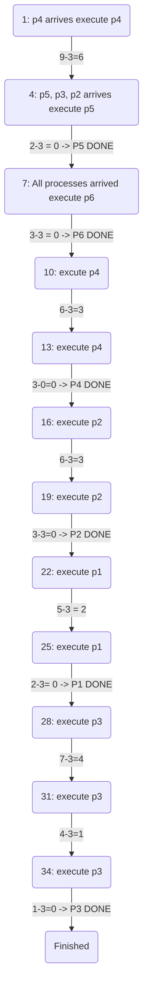
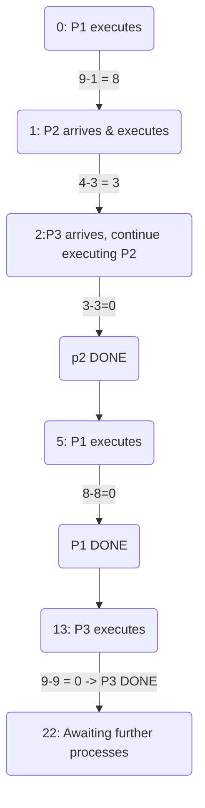

# 1. Introduction / Pre-Class Notes

```ad-abstract
title: Summary
```

## Pre-Class Notes

# 2. Lecture & Discussion Notes

## Introduction

### Why is Synchronization Important?

```ad-example
Lets say we have a two-bedroom apartment with 4 people
- 2 from the United States, 1 transfered from Asia, 1 transfered from the Middle East
```

- They all have to share a bath and a TV
- The TV can be shared, but a program has to be selected
- A bath only has a single instance and can only be used one at a time

In this case, the bath is a single instance of a **shared resources**

```ad-warning
This has become a big problem to solve as *how* do we share these resources without causes bottlenecks. Ex. How do the students take a bath and get to class on time every morning?
```

### Tools/Programming Scripts 

1. **Mutual Exclusion**:
2. **Semaphores**
3. **Monitors**
4. **Hardware Locks**

```ad-important
Semaphores are teh best solution for D-OS
```

### How To *Detect* a Synchronization Problem?

```ad-example
All the other roommates are taking too long, which leads to the last roommate to have to leave the hosue without a bath.
```

For **race conditions**, we have to increase the degree of atomicity of a *semaphore*

*Lets say we have two threads that are trying to update a value at the same time*
![[Lecture 11 - Synchronization 2026-09-18 10.22.16.excalidraw]]

```ad-question
How do we synchronize the processes to find out which one is the right value at specific timestamp? 
```

## Thought Exercises Relating to Synchronization

### Question 1:

```ad-question
Find out the process Ghant chart assuming that **round robin** is used with a $TQ=3$.
```

| Processes | $A_{T}$ | $B_{T}$ | $T$ |
| --------- | ------- | ------- | --- |
| 1         | 5       | 5       | –   |
| 2         | 4       | 6       | 11  |
| 3         | 3       | 7       | 18  |
| 4         | 1       | 9       | 27  |
| 5         | 2       | 2       | 29  |
| 6         | 6       | 3       | 32  |


## CPU Burst vs. I/O Burst on Processes

- A CPU executes a single thread that last a long time (*CPU Burst*)
- The I/O executes multiple threads that last a short period of time (*I/O Burst*)

We have to control when these events happen to maximize the use of the critical section (`CS`)
- Priority scheduling (give priorities to both instructions so that they run intermittently). At the cost of *context switching time*

## Shortest Remaining Time First (SRTF)

- A preemptive algorithm that always selects the shortest remaining job regardless of its arrival time

### Example 1

| P   | $A_{T}$ | $B_{T}$ |
| --- | ------- | ------- |
| P1  | 0       | 9       |
| P2  | 1       | 4       |
| P3  | 2       | 9       |



### Example 2


| Process | Total BT | I/O BT | CPU BT | I/O BIT |
| ------- | -------- | ------ | ------ | ------- |
| P1      | 10       | 2      | 7      | 1       |
| P2      | 20       | 4      | 14     | 2       |
| P3      | 30       | 6      | 2      | 3       |

Runs from 0→47

#comebacklater 


# 3. Action Items & Follow-Up
- [x] Read through scheduling notes for D-OS 📅 2026-09-23 ✅ 2026-09-23
- [x] Review Lecture 11 for D-OS 📅 2026-09-21 ✅ 2026-09-21