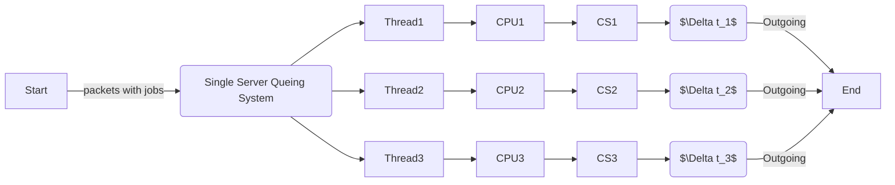
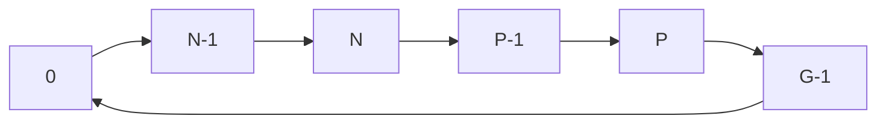

# 1. Introduction / Pre-Class Notes

```ad-abstract
title: Summary
- Race Conditions
- Critical Section Problem (aka. Producer/Consumer Problem)
```

## Pre-Class Notes
# 2. Lecture & Discussion Notes

## Race Conditions

```ad-summary
Several processes access adn manipulate the same data concurrently and the outcome of the execution depends on the particular order in which the access takes place.
```

*Example*: two counters adding to a register:
1. S0: producer executes `register1 = counter` (r1 = 5)
2. S1: producer execute `register1 = register1+1` (r1 = 6)
3. S2: consumer execute `register2 = counter` (r2 = 5)
4. S3: consumer execute `register 2 = register2 - 1` (r2 = 4)
5. S4: producer execute `counter = register 1` (counter = 6)
6. S5: consumer execute `counter = register2` (counter = 4)

Think about it as one thing hpapens before naother relationship:

$$
\Delta t_{1} > \Delta t_{2}
$$


*for single core systems*

- Processes come in, and come out with the same values
- Ex. $t_{1}, t_{2},t_{3},t_{4} \Rightarrow t_{1},t_{2},t_{3},t_{4}$


*for multicore systems*

- Multiple packets arrive at the same time into multiple threads and run on different CPU cores
- Leads to processes returning at different orders
- ex. $t_{1},t_{2},t_{3},t_{4} \Rightarrow t_{3}, t_{2},t_{4},t_{1}$
- We must increase the **degree of atomicity** in order to avoid *race conditions*

```ad-important
If the outgoing link is going over a network, the **Internet's Transport Layer** is responsible for ordering them.
```

## Types of Queues

### Bounded and Unbounded Buffers

![[Lecture 12 - 2026-09-21 10.30.25.excalidraw]]
Bounded buffer takes a small portion of main memory:

$$
64 \text{bits} \Rightarrow 8 \text{ Bytes} \times 9 = 72 \text{ Bytes}
$$

### Circular Queue



- Linear queues make up the circular queue
- Typically found on the *transport layer*
- We use the *mod* function on circular queues to return from 0 to `max_index`
- ex. 0 mod 8 = 0 AND 8 mod 8 = 0

## Consumer and Producer Problem

```ad-warning
Queues are limited by:
1. The producer producing multiple items (1 OR more)
2. Consumer only using one item whenever he is active (*woken up*)
```

**Overflowing**:

```ad-summary
A problem when the producer creates items faster than the consumer can remove from the queue
```

![[Lecture 12 - Critical Section & Race Conditions 2026-09-21 10.45.48.excalidraw]]

1. Producer creates three new items and goes to sleep
2. Consumer wakes up and only consumes one item
3. This continues until the *queue is full*
4. Note: orange arrow represents how the values move down to be executed in the queue

**Underflowing**:

```ad-summary
A problem when the consumer uses items faster than the producer can add them to the queue
```

1. Producer creates two new items and goes to sleep
2. Consumer wakes up and can consume up to three items
3. The queue will never fill up and the consumer will be left underutilized for one task every cycle 

*Producer/Consumer Dynamic*

| Producer | Consumer |
| -------- | -------- |
| Wakeup   | Sleep    |
| Sleep    | Wakeup   |

### How Do We Fix This?

1. User control
2. Give control to the computer

Uses *subprocesses* to control when either the producer or consumer wakes up/sleeps efficiently to assure maximum utilization without letting the queue fill too quickly

## Critical Section Problem

```cpp
while (true) {
	// Entry Section
		 //Critical Section
	//Exit Section
	//Remainder Section
}
```

1. The process enters the critical section through the *entry section*
2. The *critical section* is the process that is currently running on the CPU and will keep running without interrupt
3. The *exit section* is where the process exits the critical section
4. The *remainder section* is the rest of the process’ code that does not need the critical sectio after it exits 

```ad-note
For the sake of this class, there are two critical sections and two exit section
```

This is done via the `fork()` command:

```ad-example
What if we have two processes created at the same time?
```

![[Lecture 12 - Critical Section & Race Conditions 2026-09-25 10.23.29.excalidraw]]

```ad-warning
If not mutex is provided, then two processes might have the same process id and one of them will be lost when it is executed
```
# 3. Action Items & Follow-Up
- [x] Review Lecture 12 for DOS 📅 2026-09-23 ✅ 2026-09-23