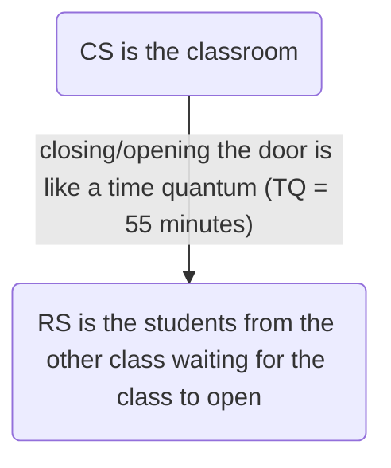

# 1. Introduction / Pre-Class Notes

```ad-abstract
title: Summary
```

## Pre-Class Notes
# 2. Lecture & Discussion Notes

## Solution to the Critical-Section Problem

### Classical OS Solutions

1. **Mutual Exclusion**: If the process $P_{i}$ is executing in its cirtical section, then no other processes can be executing in their critical sections
2. **Progress**: If no process is executing in its ciritcal seciton and there exist some processes that wish to enter their critical section, then the selection of the processes that will enter the crtiical section next cannot be postponed indefinitely
3. **Bounded Waiting**: A bound must exist on the number of itmes that other processes are allmowed to enter their critical sections after a process ahs made a request to enter its critical seciton and before that request is granted
	- Assume that each process executes at a nonzero speed
	- No assumption concering *realtive speed* of the $n$ processes

```ad-note
Very related to the supply-demand chain. Some resources will be more popular than other resources, leading to some processes demanding the same resource at the same time. We need to control this access so all resources can be accessed fairly and within the required execution time.
```

#### In Terms of the Producer and Consumer

| Time ($\micro s$) | Producer                                      | Consumer                                                                               |
| ----------------- | --------------------------------------------- | -------------------------------------------------------------------------------------- |
| —                 | *Multiple Items*                              | *Single Item*                                                                          |
| 1                 | Slot 1 filled                                 | Idle                                                                                   |
| 2                 | 2&3 filled                                    | Idle                                                                                   |
| 3                 | 4 filled                                      | Idle                                                                                   |
| 4                 | 5 filled                                      | Idle                                                                                   |
| 5                 | Queue Filled ($Q$)                            | Idle                                                                                   |
|                   | **Overflow**: Producers *cannot* add any more |                                                                                        |
| 6                 | Idle                                          | Does not want to grab any slots because they are not important to execute (low demand) |
| 7                 | Locked Out                                    | Sleeping                                                                               |

```ad-important
To avoid this, D-OS tries to use the **highest degree of multiprogramming**. To accomplish this, it either uses:
1. **Multiple** producers and a *single* consumer
2. **Multiple** producers and **multiple** consumer
```

```ad-note
Out of all major programming languages, **Java** is often used for normal OS because it contains:
1. Highly-efficient *multi-threading*
2. *Hyperthreading* if needed
```

However, for D-OS, we often use **DLE**

#### The Nitin Question$^{\text{tm}}$

```ad-question
How will we handle one producer out of a lot of the same consumers?
```

Well see[[Lecture 14 - Deadlock| The Next Lecture]] ig lol.

### DLE Layout

Inside a Queue Structure $s$ in a distributed operating system, we have a multiple *linked list* Queues ($Q_n$). 
- Let us assume $n=3$, one for  each major program we are running

| $Q_{1}$ | $Q_{2}$ | $Q_{3}$ |
| ------- | ------- | ------- |
| T001    | T010    | T100    |
| …       | …       | …       |

We have to make sure that:
1. The producer is adding threads to each of these queues evenly
2. The consumer is executing & removing threads from each of these queues evenly
### Using Semaphores

```ad-note
title: Remember
A little reminder from undergrad
![[Operating Systems - Week 9 Day 1#Software Support for Mutual Exclusion Semaphores]]
```

#### Types of Semaphores

1. **Binary Semaphore (aka. `Mutex`)**: Creates mutual exclusion with `0` or `1`
2. **Counting Semaphore**: Allows the management of multiple resources $0 \to n$

### Monitors

```ad-example
Assume that the teacher leaves the classroom in grade school. Someone becomes the class monitor. Monitors work on a very similar concept very similar.
```

## The Classical CPU Sync Problems
1. Producer/Consumer Dynamic
2. Sleeping Teaching Assistant → *friday solution…* [[Lecture 14 - Deadlock]]
3. Sleeping Barber → Multiple sleeping barbers are placed in front of hairdressing chairs when multiple customers walk in. *friday solution…* [[Lecture 14 - Deadlock]]
4. Sleeping Philosopher
5. Dining Philosopher
6. Cigarette Smoker Problem → Monitors + Semaphores (*Hybrid Solution*)
7. Drinking Philosopher Problem → Unique problem that needs solved using **reading** and **writing** **control**
8. Stable Roommate
9. Stable Chessmate

```ad-quote
"To become a good philosopher, make sure to start smoking and drinking. There will be no competition on the Ph.D."
```

*now ai glaze*

```ad-tldr
Something something use AI, but don't cheat with it by getting the straight answer and copy/pasting it and *reference* it
```

## Critical Section/Remainder Section Analogy



To control this, there is a `mutex` flag such that:
- $\downarrow$ flag 1/set/up/on
- $\uparrow$ flag 0/reset/down/off
# 3. Action Items & Follow-Up
- [x] Review Lecture 13 for D-OS 📅 2026-09-25 ✅ 2026-09-25
- [x] Assignment 1 for D-OS ⏫ 📅 2026-10-02 ✅ 2026-10-05
- [x] Send notes over 📅 2026-09-23 ✅ 2026-09-23

