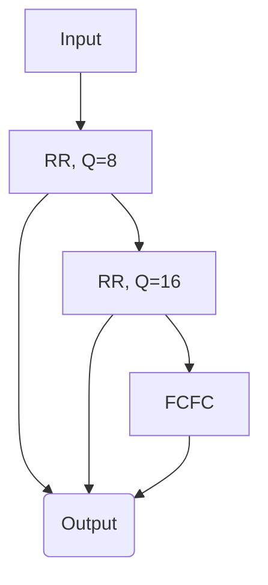

# 1. Introduction / Pre-Class Notes

```ad-abstract
title: Summary
```

## Pre-Class Notes

#### Assignment 2: Creative Design Thinking Problems on OS

```ad-note
- C, C++, and JAva as a language while you want to code the problems
- `srand()` is good enough for randomization
- If you have any feelings regarding the non-preemption and preemption then use only roudn robin scheduling with preemption
- Earliest-Deadline-First (EDF) may also be useful
- Avoid Rate-monotonic
- Take all the assumptions whenever and wherever it is necessary and just record them in the file
- Testing must be done via *alpha & beta testing*
```

**Clock**: should use the chrono library’s high resolution clock class:

```c++
#include<iostream>
#include<chrono>
typedef std::chrono::high_resolution_clock Clock;

int main() {
	auto t1 = Clock::now();
	auto t2 = Clock::now();
	std::cout << "Delta t2-t1:"
	<< std::chrono::duration_cast<std::chrono::nanoseconds>(t2-t1).count();
	<< "nanoseconds" << std:endl;
}
```

*Six Large Questions*:
1. The Barber Problem
2. Smoker Problem
3. TA Problem
4. Readers/Writers Problem
5. Bridge Problem (Deadlock Condition) 
	- From North Caroline University
	- Modify the problem so that it is starvation free
6. Drinking Philosopher

```ad-note
For the drinking philosopher problem, there is a reasearch paper that has the solution to this problem.
```

- For the game of craps, the story and the problem will be sent to us so we can implement it effectively.
# 2. Lecture & Discussion Notes

## Multi-Level Feedback Queues

Multiple different queuing algorithms can be used at the same time in an attempt to guarantee real-time scheduling.


# 3. Action Items & Follow-Up
- [x] Review Lecture 16 for DOS 📅 2026-10-02 ✅ 2026-10-05