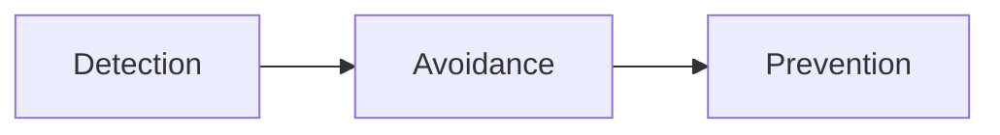

# 1. Introduction / Pre-Class Notes

```ad-abstract
title: Summary
```

## Pre-Class Notes

- You need to look over and understand the hospital problem
- Do not miss class on Friday because he will give out a free question from the exam!

![[sl7.pdf]]

![[ch7 Deadlocks.pdf]]
# 2. Lecture & Discussion Notes

## Resource Allocation Graph

```ad-note
Went over this with the class pre-readings
```

1. Process

![[Pasted image 20261007101712.png]]

2. Resource Type with 4 Instances

![[Pasted image 20261007101724.png]]

3. $P_{i}$ requests instance of $R_{j}$

![[Pasted image 20261007101743.png]]

4. $P_{i}$ is holding an instance of $R_{j}$

![[Pasted image 20261007101749.png]]

## Basics for Dining Philosophers

- Need an enumerated states!
- Setup variables with assumptions
	- Number of meals
	- Max wait time
	- Number of philsoophers
	- Work_time
- Use c threads 

```c++
enum states
{
	THINKING, EATING, HUNGRY
};
```

## Handling Deadlocks

1. Prevention (makes sure one of the four necessary conditions for deadlock cannot be held)
2. Avoidance (An operating system **method** (aka. *process*) that makes sure processes inform the OS of which resources they will hold so the system can approve and deny requests if it were to create a deadlock or not)
3. Detection (purposefully enter the deadlock, and then detect it)
4. Recovery (after detecting it, use algorithms to revert to a state before the deadlock happened)

```ad-warning
Each one of these solutions have their own algorithm, with some of them being considered "better" than others.
```

*Best to Worst*


```ad-question
![[Pasted image 20261007103026.png]]

Does this cycle here have a deadlock?
```

**NO!**, there is enough copy of each resource $R_{1}, R_{2}$ to handle each process.

```ad-question
How about this one?

![[Pasted image 20261007103357.png]]
```

*Yes!*, There are not enough copies of $R_{1}, R_{2}, \text{and }R_{3}$ such that $P_{1}, P_{2}, P_{3}$ creates a cycle where a $n$ processes claims $n$ copies of a resource while the others request the same amount.

## Semaphores for the Exam

```ad-summary

Every time you want to build a problem around mutual exclusion, *especially on the exam*, make sure to use **semaphores**
```

- Make sure you set it to be a counting or binary semaphore ($S=n$)
- $n$ is the number of copies available for a specific resource
- `signal` to release, `wait` to request

```ad-warning
We do **not** want to use `mutex` in this class! Semaphore does everything mutex does but better
```

```ad-important
Slide 3 is **super important** for the exam
```
## Safety Algorithm

**Steps**:
1. Let *work* and *finish* be vectors of length $m$ and $n$, respectively. Initialize:
```c++
work = available
finish[i]=false for i=0,1,...,n-1
```
2. Find $i$ sucht hat both:
	- $Finish[i] = false$
	- $Need_{i}\le Work$
	- if no such $i$ exists go to step 4
3. $Work = Work + Allocation_i$
	- $Finish[i]=true$
	- Go to step 2
4. If $Finish[i]==true$ for all $i$, then the system is in a safe state


# 3. Action Items & Follow-Up
- [ ] Review Lecture 19 for D-OS 📅 2026-10-09
- [ ] Understand hospital problem 📅 2026-10-09
- [ ] Start Anki study deck for D-OS midterm 📅 2026-10-09