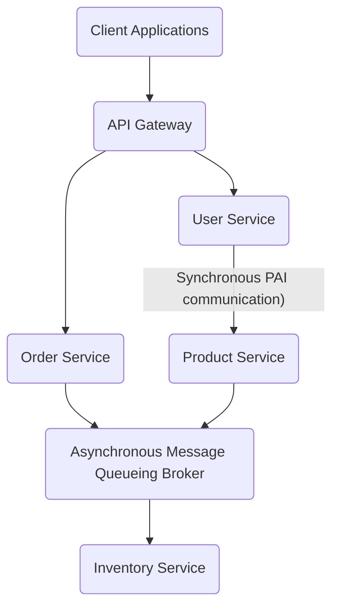
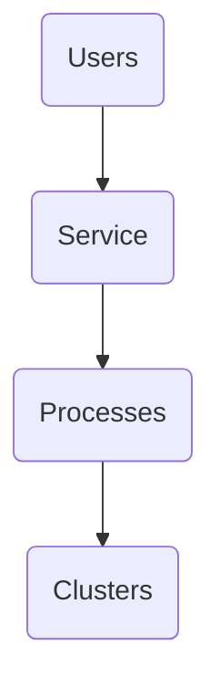

# 1. Introduction / Pre-Class Notes

```ad-abstract
title: Summary
```

## Pre-Class Notes
# 2. Lecture & Discussion Notes

## What goes into a Distributed Operating System (up to this point)

1. Clocks
2. Locks
3. Process SYnc
4. Process scheduling
5. Deadlocks
6. Database
7. Fault toelrance

## Example 1

Imagine that millions of customers are shopping at an online store, such as Amazon. The 
- The system is not one computer. It consists of *hundreds or thousands of computers/server* distributed across different locations

![[b42fe85e-fe56-4a37-8b50-64eea21a74c5.jpeg]]

```ad-note
The blue is the API Gateway
```

Looking at the diagram, the information moves from **top to bottom**
- 
## Microservices Architecture



Follows a Left→Right OSI model (Application all the way down to the physical layer)

```ad-note
title: Remember
**Routing** is done at the router level. Routers can be found at the network level and transport level.
```

**Distance-Vector Multirouting Protocol (DVMRP):** a distributed protocol that is often necessary to get data from one system to another.
- Often used in WANs

### Load Balancing for API Gateway

```ad-example
We will be focusing on Green clouds
- Pull/push migration
```

```ad-note
title: Remember
KERBEROS V is the current industry standard; however, RSA + SHA are often used
```

**Key Exchange Protocol Ranks**:
1. OatwayREES
2. Diffie Hellman (DH)
3. Needham Schroder

## Layer Differences

- At the API/Application layer, which protocol is used?
	- **BINARY** for end-to-end servies
	- Critical due to it being necessary for process sharing
	- Some operations can be persistent (http 4.0)
- At the data-link layer, we are using the **sliding window
	- Broken down into 4 different protocols
	- Acts as a double-ended queue, which also helps serve the TCP/IP
- At the Transport layer, it is TCP/UDP
- At the Network layer, it is IP
- The physical layer has a few sublayers
	- *Medium access layer control (MAC)*

```ad-important
This means that every layer serves each other, rather than the services only working one-way
```

```ad-warning
For distributed systems, we would like to *avoid* some services, especially **SQL**. We would like to choose alternatives for these services such as NOSQL HBASE and green cloud
```

## Cloud as a Service

1. Infrastructure as a service (IAAS)
2. Platform as a service (PAAS)
3. Software as a service (SAAS) 
	- Ex. MATLAB
4. Cloud as a service (CAAS)

All of the three services (IAAS, SAAS, and PAAS) make up the cloud, which can further be used as a service

## Distributed Systems as Supercomputers

Assuming the following:



We can assume that a combination of each of these processes act as a *super computer* due to the transparencies in place on the system.


## Distributed Processes as a Shopping System

Think of the shopping system as a huge company

There are different workers:
1. Web server → receives customer’s request
2. Authentication server → verifies the customer
3. Producer server → provides product information
4. Inventory server → checks availability
5. Payment server → processes payment
6. Order server → creates the order
7. Shipping server → arranges delivery

```ad-note
This can be easily applied to the OSI model
```

Each server runs one or more processes, with each of these processes executing on completely different computers

### Example

Let us assume Alice clicks the “buy iPhone” button and with Bob taking care of the order:
- Alice and Bob have their own 7 layers
- They are connected in *parallel* over the network link

These are *distributed processes* because they cooperate while running on different machiens

```ad-important
A **distributed process** is a prcoess participating in a computation whose components execute on different networked computers.
```

## CPU Synchronization as Worker Coordination

Now imagine two employees, Alice and Charlie, simultaneously wanting to buy the same iPhone.
- Both see that one is left

If both buy it at the same time *without synchronization*, we will have a serious error where negative inventory would occur

Therefore, processes, must **share resources** and use synchronization to ensure that one user does not cause another user to cause a fault.

## CPU Scheduling Choosing who get the CPU next

Suppose the inveontory server receives multiple processes. It will be chosen by CPU scheudling:
1. FCFS
2. Priority
3. Round Robin

```ad-important
Distinction:
1. CPU Synch asks
2. CPU Scheduling asks
   #comebacklater 
```

### What happens when the servers are not in synch with the global clock

Let us assume server A is 2 seconds faster than Server B:
- Alice buys the phone on server A
- Bob buys the phone on server B

Physical clocks may be wrong, so we have to rely on **logical clocks**
- We will find that Alice buys the phone since it is casualy orderd
- Lamport Logical Vector Clock captures, while Logical Clock preserves

We will find that the processes are causally ordered, with Alice getting it first because it came first.

## Locks

Use distributed locks to decide which process can edit a resource at a certain time to avoid data loss and data consistency faults.

```ad-important
Even though Alice and Bob have access to the machine at the same time, only one of them should be able to access the lock
```

## Leader Election Problem

Use bully or ring election to figure out which process will be the next leader

## Deadlock

Suppose taht Process A is waiting for the inventory lock, while B is waiting for the payment lock, but neither of them are removing their hold
- Causes a circular wait and a deadlock!

## Databases and Concurrency Control

To ensure a database is properly updated when a change happens on the distributed network, we need to ensure concurrency control
- Assume that Alice → UPDATE inventory and Bob → Update inventory
- We have to make sure that the database results in the correct state after both of these updates

We need #comebacklater 

## Shared Memory

A process writes a value, while B process reads it
- Who is allowed to modify the shared information, and when?
- That is why **shared emmorya nd synchronizationare closely connected**
- D-OS shared memory is implemented using network communication, replicated state, distributed shared-memory mechanisms, chases, or a database
- **Memory mapping** is *critical*
# 3. Action Items & Follow-Up
- [ ] Review Lecture 21 for D-OS 📅 2026-10-16