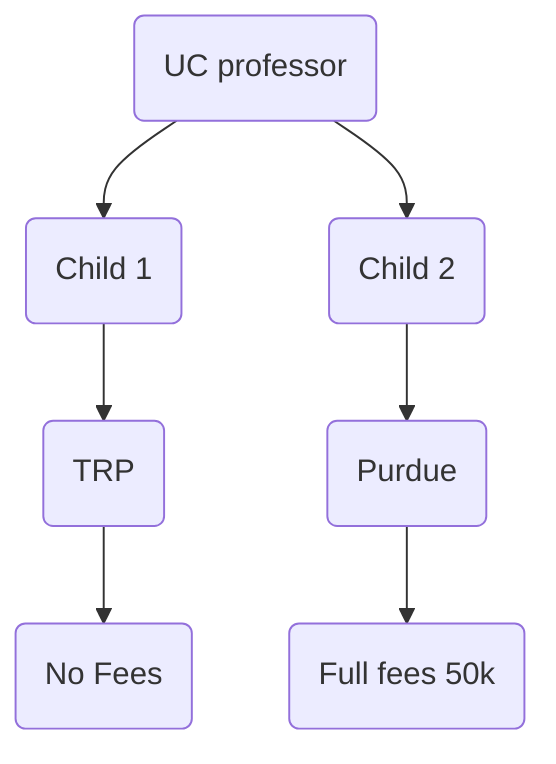
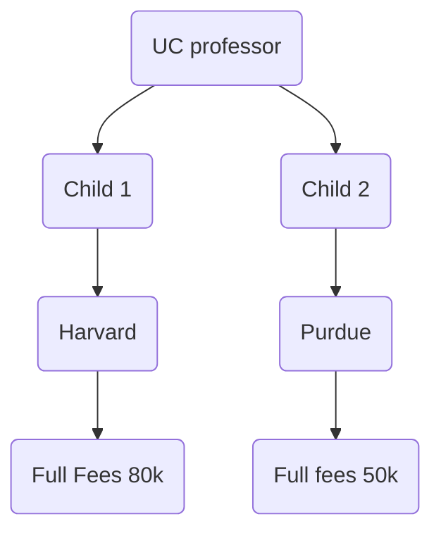
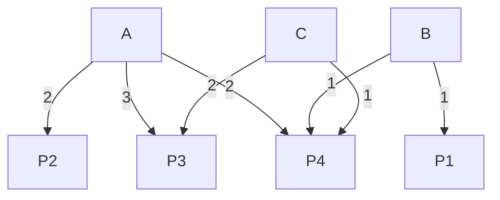

# 1. Introduction / Pre-Class Notes

```ad-abstract
title: Summary
```

## Pre-Class Notes
- Based on notes taken from the 7th slide deck. Check Zotero for more
# 2. Lecture & Discussion Notes

## Example: Tuition Remission



The professor is *safe* because he saved some money from remission



The professor is in an *unsafe* state because he is using all his spendings to sent each child to college separately.

## Numerical 1: Deadlock Handling $\star$

### Introduction

The main idea is to determine if a system is in a safe state.

```ad-summary
We will be covering the following topics with this example
1. Resource Allocation Graph
2. Banker's Algoirthm
3. Safety Algorithm
4. Resource-Request Algorithm
```

### Problem Statement

Consider a system with four processes: $P_{1}, P_{2}, P_{3}, P_{4}$, and *three types* of reusable resources $A, B, C$
- 10 Instances of $A$
- 5 instances of $B$
- 7 instances of $C$

**Current Allocation Matrix**

| Process   | A   | B   | C   |
| --------- | --- | --- | --- |
| $P_{1}$   | 0   | 1   | 0   |
| $P_{2}$   | 2   | 0   | 0   |
| $P_{3}$   | 3   | 0   | 2   |
| $P_{4}$   | 2   | 1   | 1   |
| **Total** | *7* | *2* | *3* |

**Maximum Allocation Matrix**

| Process    | A       | B      | C      |
| ---------- | ------- | ------ | ------ |
| $P_{1}$    | 7       | 5      | 3      |
| $P_{2}$    | 3       | 2      | 2      |
| $P_{3}$    | 9       | 0      | 2      |
| $P_{4}$    | 4       | 2      | 2      |
| **Total**  | *23*    | *9*    | *9*    |
| Difference | **-13** | **-4** | **-2** |

```ad-note
Assume that the system uses the Banker's algorithm to decide whehter the resource allocations are safe.
```

```ad-question
1. Construct the resource allocation graph (**RAG**) for the current state
2. Calculate the *available* and *need* matrices
3. Apply the safety algorithm and determine whether the current state is safe
4. Suppose $P_1$ request $(1, 0, 2)$. APply the resource-request algoirthm (**RRA**) and decide whether the request can be granted
5. Draw or update the RAG after the request is granted, if it is safe, and explain how the safety result supports the decision.
```
### Step 1: Calculate the Available Matrix

$$
\boxed{\text{Available}= \text{Total Resources} - \text{Total Allocated}}
$$


| Resource | Total | Allocated | Available |
| -------- | ----- | --------- | --------- |
| $A$      | 10    | 7         | 3         |
| $B$      | 5     | 2         | 3         |
| $C$      | 7     | 3         | 4         |

$$
\text{Available} = \left \{ 3,3,4  \right \}
$$

### Step 2: Calculate the Need Matrix

$$
\boxed{\text{Need} = \text{Maximum} - \text{Allocation}}
$$

```ad-example
For example, for $P_{1}$:
$$
\text{Need}_{1}=(7,5,3)-(0,1,0) = (7, 4, 3) \quad \checkmark
$$

```

| Process | $A$ | $B$ | $C$ |
| ------- | --- | --- | --- |
| $P_{1}$ | 7   | 4   | 3   |
| $P_{2}$ | 1   | 2   | 2   |
| $P_{3}$ | 6   | 0   | 0   |
| $P_{4}$ | 2   | 1   | 1   |
| *Total* | 16  | 7   | 6   |

### Step 3: Construct the RAG

- **Resource → Resource (Request)**: An instance has been allocated to a process
- **Process → Resource (Claim)**: A process is requesting a resource
- **Dashed Process → Resource (Allocate/Assign)**: A claim edge indicates that a process may request that resource in the future

*Allocated Resources*
1. $A(10)$: 7 allocated, 3 available
2. $B(5)$: 2 allocated, 3 available
3. $C(7)$: 3 allocated, 4 available



**Allocation Edges**:
- $A \to P_{2}$: 2 instances
- $A \to P_{3}$: 3 instances
- $A \to P_{4}$: 2 instances
- $B \to P_{1}$: 1 instance
- $B \to P_{4}$: 1 instance
- $C \to P_{3}$: 2 instances
- $C \to P_{4}$: 1 instance

```ad-note
We have no outstanding resource requests specified in the initial state, so there are *no request edges* yet.
```

```ad-warning
Because resources have ultiple isntances and the system uses the Banker's algorihtm he RAG alone is *not sufficient* to establish safety. We must use the `Need` and `Available` marices to check wehther all processes can finish.
- You should not demand in such a manner that the system mvoes to **UNSAFE** state.
```

### Step 4: Apply the Safety Algorithm 

```ad-summary
The safety algorithm determines whether there is at least one order in which all processes can complete.
```

**Initial State**:


$$
\text{Work} = \text{Available}=\left (3,3,4 \right )
$$
$$
\text{Finish}= \left [ F, F, F, F \right ]
$$

```ad-important
A process can finish **only if**:
$$\text{Need}_i \le \text{Work}$$
When a process finishes, its allocated resources are returned:
$$\text{Work}=\text{Work}+ \text{Allocation}$$
```

```ad-note
Finish is initally set to all falses until we can prove every single process is safe.
```
#### Step-By-Step Execution

1. Select $P_{2}$
	- $\text{Need} = (1, 2, 2),\text{Work} = (3,3,4)$
	- Since $(1,2,2) \le (3,3,4)$, $P_{2}$ can finish
	- Resources released: $\text{Allocation: } (2,0,0)$
	- $\text{New Work} = (5,3,4)$
2. Select $P_{3}$

**Safety Table**

| Step | Process Selected | Work Before | Work After |
| ---- | ---------------- | ----------- | ---------- |
| 1    | $P_{2}$          | $(3,3,4)$   | $(5,3,4)$  |
| 2    | $P_{4}$          | $(5,3,4)$   | $(7,4,5)$  |
| 3    | $P_{1}$          | $(7,4,5)$   | $(7,5,5)$  |
| 4    | $P_{3}$          | $(7,5,5)$   | $(10,5,7)$ |


### Step 4: Use RRA to Calculate Request

```ad-note
The request is that $P_1$ is requesting the further resources such that: $(1, 0, 2)$
```

### Step 5: Draw or Update the RAG If Request Granted
# 3. Action Items & Follow-Up
- [ ] Review Lecture 27 in DOS 📅 2026-11-02 
- [ ] Look at this for DOS exam 📅 2026-12-7 🔼 