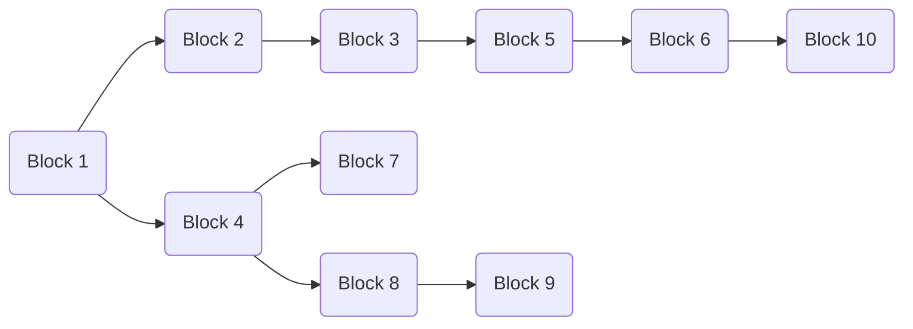

# 1. Introduction / Pre-Class Notes

```ad-abstract
title: Summary
```

## Pre-Class Notes

### Smoker Implementation
- We are often left with either monitors or semaphores to solve the problem
	- Individual semaphores are not good enough
	- Hybrid are not the correct solution
	- **Monitors are the best!**
- Agent *always* has unlimited resources
- **ALSO ON THE EXAM** #comebacklater 
	- Make sure you are careful, because you can catch the *wrong smoker*!
	- Hint: If the program is not written properly, a smoker who does not deserve the ingredient might take it

# 2. Lecture & Discussion Notes

## Proof of Work

When the first-ever cryptocurrency was made, aka. Bitcoin, he had to find a way for transactions to be verified without the need to use a third party. This is where **proof of work** was created.

```ad-summary
Proof of Work is used to determine *how* the blockchain reaches **consensus**.
- How can the network be sure that the transaction is valid and that soemone is not trying to do bad things, suh as spend the same funds twice.
```

**Proof of Work**: 
- Primary goal is to find the correct *nonce*
- Worse than Proof of Stake in most instances
- Based primarily on comparisons from multiple different sources to find the nonce that is the closest
- Needs to have the most robust solutions
- On tie, you either take both of them or dump both of them until a better solution is found
- Slow exponential growth 
- Much heavier
- ex. Bitcoin


### Proof of Work Simple Example

1. The proof of Work mathematical $\text{sum} = 5 + 7$
2. The answer is 12
3. Whoever gets the answer first, wins the mining rward
4. Mienr 1 and Miner 2 compete with each other, with the results displayed below:

**Miner 1:**
1. $5 + 7 = 10 \quad X$
2. $5 + 7 = 13 \quad X$
3. $5 + 7 = 9 \quad X$

**Miner 2**:
1. $5+7=17 \quad X$
2. $5 + 7 = 8 \quad X$
3. $5 + 7 = 12 \quad \checkmark$

### Proof of Work Chain Example



## Proof of Stake

```ad-summary
Instead of solving complex equations and rewarding miners to do so, Proof of Stake makes the individual create the enxt block based on how much they have "staked".
- The stake is based on the number of coins the person has for the particular blockchain they are attempting to mine
```

- Instead of mining, they forger, because there is no block reward.
- Those who contribute to the system earn a transaction fee instead each time they add a block to the chain.
- You need to put down your stake to win this transaction fee
- Whoever stakes the maximum amount wins
- In this case, it is who has the most amount of coin

*How are they Verified*
1. You decide you want to stake ocins to earn some Proo fo Stake rewards
2. 

**Proof of Stake**:
- Better than Proof of Work in most instances
- *Main Problem*: it also can be biased
- Much like gambling
- Linear growth
- Lighter
- Ex. Modern Ethereum
# 3. Action Items & Follow-Up
- [x]  ✅ 2026-08-24