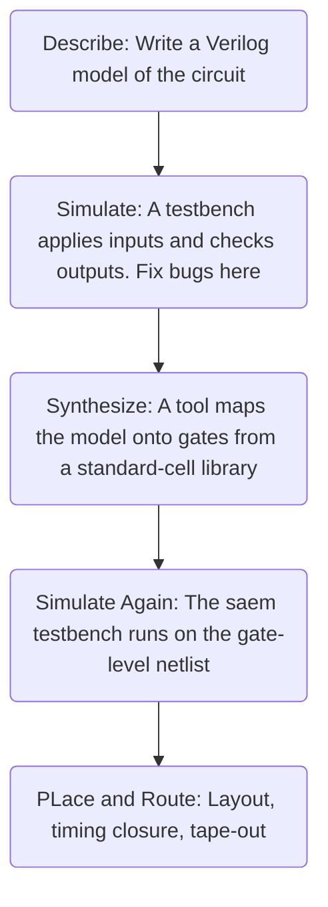

# 1. Introduction / Pre-Class Notes

```ad-abstract
title: Summary
```

## Pre-Class Notes
# 2. Lecture & Discussion Notes

## Introduction

```ad-note
Specifically, Verilog-2001 will be taught in terms of ASIC design.
```

## Verilog to Silicon



**Design Models**: code that describes the circuit must be syntehsizable. A tool turns it into gatess.

**Testbench**: Used to test the circuit to make sure it works before routing and placement happens

## Example 1: The 1-bit Full Adder

![[Pasted image 20261014123036.png]]

![[Pasted image 20261014123040.png]]

**Sum $S$**:


$$
S = A \oplus B \oplus cin
$$

$$
cout = A \times B + B \times cin + A \times cin
$$
### Gate level Model

![[Pasted image 20261014123526.png]]

```Verilog
`timescale 1ns / 1ps

module fulladder( 
	input A, B, cin,
	output S, cout
);
	xor (S, A, B, cin);
	
	and (a1, A, B);
	and (a2, B, cin);
	and (a3, A, cin);
	or (cout, a1, a2, a3);
endmodule
```

```ad-summary
**Structural model** lists components and the wires between them. It is a like a schematic written in text.
```

## Nets

```ad-summary
A *Net* carries a value form the gate that drives it to the gates that read it.
```

- Our listing never declare `a1`, `a2`, `a3`. An undeclared name in a connection becomes an **implicit 1-bit wire**.

## Statements are Hardware, NOT steps

The following verilog below will result in the same circuit:
```Verilog
or (cout, a1, a2, a3);
and (a3, A, cin);
xor (S, A, B, cin);
and (a1, A, B);
and (a2, B, cin);
```
## Testbenching

```ad-summary
A module with no ports that sits on top of the simulation.
- It instantiates the design, drives its inputs and observes its outputs
- It is never synthesized.
```

```verilog
module tb_fulladder;
	reg A, B, cin;
	wire S, cout;

fulladder dut(.A(A), .B(B), .cin(cin), .S(S), .cout(cout));
end module
```

- *No Port list*: Nothing exists outside the testbench, so there is nothing to connect to
- *Reg and wire*: Reg is a variable that prodecural cod eassigns and that holds its value. A wire is driven bya  gate or module output
- *Module instance*: Module name, instance name, then connections by name: `.port(singal)`. The order no longer matters.

![[Pasted image 20261014124456.png]]

### Procedural Code for Applying a Stimulus

```Verilog
integer i;

initial begin
	for (i=0, i < 8; i = i + 1) begin
		{A, B, cin} = i[2:0];
		#10;
	end
	$finish;
end

initial
	$monitor("&3d: %b%b%b -> %b%b", $time, A, B, cin, cout, S);
```
Where:
- **Variable**: A loop counter for the testbench
- **Initial block**: starts at time 0 and run
- **Stimulus**: The braces join the three regs so the loop applies 000 to 111. #10 wait is for 10x our timescale ($1*10 = 10ns$)
- **System Task**: Names that begin with `$` are commands for the simulator . In this case `$finish` stops simulation, here at 80ns
- **$monitor**: Prints a line whenever a listed signal changes, for example: “30: 011→”. A text version of the waveform.

```ad-important
Even in procedural code, tasks run in parallel of each other!
```

### Simulation of all eight inputs

![[Pasted image 20261014130117.png]]

## Example 2: An $N$-bit adder built from full adders

![[Pasted image 20261014130204.png]]

- Stage $i$ adds $A[i], B[i]$ and the carry from stage $i-1$. The carry *ripples* from bit 0 up to bit $N-1$.
- We already have the full adder module. Using it $N$ times makes this a **hierarchical structural model**
- Written with a width parameter $N$, one description covers every size, aka it is *scalable*.
## Hierarchical model

```Verilog
module adder1 #(
	parameter N = 16
) (
	input [N-1:0] A,
	input [N-1:0] B,
	input cin,
	output [N-1:0] S,
	output cout
);
	wire [N:0] carry;
	genvar i;
	assign carry[0] = cin;
	assign cout = carry[N];
	generate
		for(i = 0; i < N, i = i + 1)
		begin : stage
			fulladder fa (A[i], B[i], carry[i], S[i], carry[i+1]);
		end
	endgenerate
endmodule
```

1. **Parameter**: A generic parameter that is defined at compile time. Like a static variable. 
2. **Vectors**: $[N-1:0]$ defines an $N$-bit bus instead of $N$ separate wires
3. **Continuous assignment**: Assign drives a net from an expression, all the 
4. **Generate loop**: Inside this loop, a labelled form create $N$ copies of hardware
5. **Module instance**: Example 1 is reused as a *componenet*, taking advantage of hierarchy. 

### Names in the Hierarchy

![[Pasted image 20261014131551.png]]

Full name of net `a1` inside of the 2nd bit:
```Verilog
tb_adder.sa.stage[2].fa.a1
```

## Example 2 Testbench

```Verilog
module tb_adder;

parameter N = 4;

reg[N-1:0] A;
reg[N-1:0] B;
reg cin;
wire[N-1:0] S;
wire[N-1:0] cout;

// For Random Number Generator
integer i, seed;

adder1 # (
	.N(N)
) sa (
	.A(A), .B(B), .cin(cin), .S(S), .cout(cout)
);

	initial begin
		A=0;
		B=0;
		cin = 0;
		
		#120
		seed = 10;
		
		for (i = 0; i < 100; i + i + 1) begin
			A = $random(seed);
			B = $random(seed);
			cin = $random(seed);
			
			#((N+1 * 40));
			
			if ((S + (2**N)*cout) !== (A + B + cin)) begin
				$display("Test fialed; got A B cin S cout as %d %d %d %d %d", A, B, S, cout);
				$finish
			end
		end
	$display("Test passed: All data is correct");
	$finish
	
	end // of the initial block
endmodule
```

### Simulation Checking using Waveforms

![[Pasted image 20261014133818.png]]

- The first 120ns contains inputs that hold their intiial zeros. The random tests begin after the #120 delay
- 200ns per test: based on the fomrula. Vectors A, B, and S are shown in decimal
- 320 to 520ns: $0 + 15 + 1 = 16$, too big for 4 bits, so S = 0 and cout = 1

## Example 3: Adder2 Flat Structural Model

```ad-summary
Written in a certain way so that there is not a separate full adder:
- Same parameter, ports and cary chain as adder1
- No module isntances: every gate sits directly in adder2. The model is *flat*
- Initernal nets are $N$-bit vectors, on bit per stage: $x1[i], a1[i]$ and so on.
- Two-input gates only: seven per bit
```

![[Pasted image 20261014134221.png]]
```Verilog
module adder2 #(...)(...) // as adder1
	wire [N:0] carry;
	wire [N-1:0] x1;
	wire [N-1: 0] a1, a2, a3, o1;
	genvar i;
	assign carry[0] = cin;
	assign cout = carry[N];
	generate
		for (i = 0; i < N; i = i + 1)
		begin : stage
			xor (x1[i], A[i], B[i]);
			xor (S[i], x1[i], carry[i]);
			...
```
#comebacklater 

## Hierarchical Vs. Flat

**In synthesis, both are the same essential logic**. However, hierarchy keeps it readable, while flattening it will optimize across the module boundaries.

## Midterm

- 5 questions
	- Basic sizing
	- Elmore Delay
	- Clocking
	- Dynamic Performance Analysis

UNDERSTAND THE QUIZ QUESTIONS


# 3. Action Items & Follow-Up
- [ ] Review Lecture 15 for VLSI📅 2026-10-16 